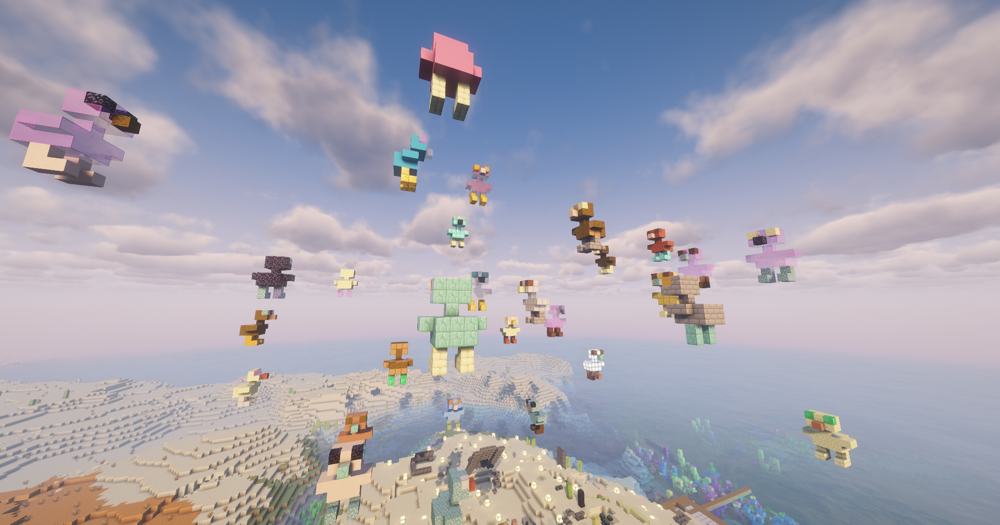
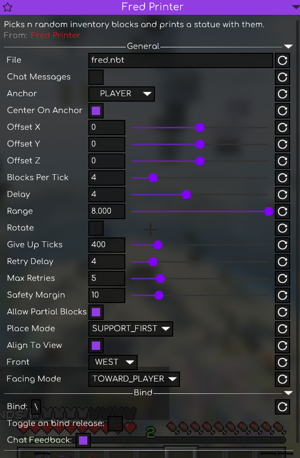

## Fred Printer 

This Meteor module lets us print an enormous variety of Freds in massive quantities!

How to use :
- put the fred.nbt file into .minecraft\meteor-client\statues (create the "statues" folder if it doesn't exist yet)
- configure the settings, Fred printer is in mics category. (i recommend turning on chat messages the first time you use it)
- put stacks of the building blocks you want to build Fred with into your inventory (not the hotbar)
- bind a hotkey to the module, standing where you wanna build Fred
andd start printing!

+ you can print anything with this: convert any schematic to a .nbt file, put it into the statues folder, and set the file name in the module settings
+ it wont start printing if you dont have enough blocks

 

 

the below is my config, and it works pretty well on 6b6t

